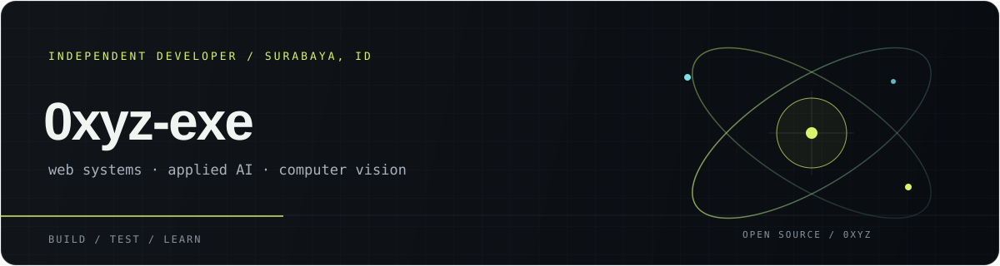

  
  
  

# SYSTEM IDENTITY / 001

**Building systems at the edge of software and intelligence.**

I design and engineer web applications, AI-driven tools, multi-agent orchestration systems, and computer-vision pipelines. Full-stack developer and ML engineer based in Surabaya, Indonesia.

[OPEN PORTFOLIO ↗](https://0xyz-exe.github.io/)

FIELD NOTE / Interface systems · orchestration experiments · applied vision

---

## 00 / Engineering Philosophy

I build software where clarity, maintainability, and practical problem-solving matter more than unnecessary complexity. 

**Core principles:**
- Ship working solutions, iterate from real constraints
- Automation and developer tooling unlock leverage
- AI systems need verifiable outcomes, not just impressive demos
- Document limitations honestly; prefer transparency over marketing

**Current focus:**
- Full-stack web engineering (Next.js, TypeScript, FastAPI, Python)
- Multi-agent workflows and LLM orchestration
- Computer vision applications (OpenCV, YOLO)
- Developer tooling and automation systems

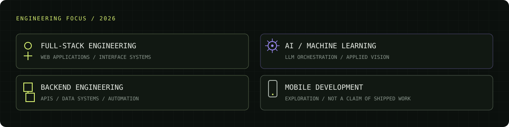

---

## 01 / Technical Stack

  

**Additional verified technology icons:** C++ · FastAPI · NestJS · Prisma · SQLite · Three.js · Vitest

  
  
  
  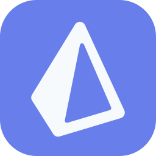
  
  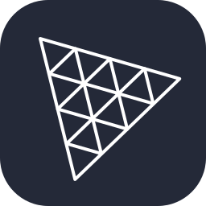
  

**Also in the featured projects:** FastAPI · NestJS · SQLAlchemy · Prisma · Socket.IO · Qdrant · Celery · MinIO · OpenCV · YOLO · Streamlit · Blade

**Icon sources:** [Skill Icons](https://github.com/tandpfun/skill-icons), MIT License. SVG files are unmodified source assets. Items without verified icon matches remain text-only.

**Languages:** PHP, Python, JavaScript, TypeScript, C++, Lua **Web Frameworks:** Next.js, React, Laravel (Blade), NestJS, FastAPI, Tailwind CSS **Data & Storage:** PostgreSQL, Redis, Qdrant (vector search), SQLAlchemy, Prisma **AI/ML:** OpenCV, YOLO, LLM orchestration, RAG pipelines, Streamlit **Infrastructure:** Docker, Git/GitHub, Celery, MinIO/S3

---

## 02 / Project Index

Each panel is an original illustration of a documented project concept, not a screenshot or a claim that an integration is production-ready.

<code>PROJECT / 001</code> &nbsp; <code>AGENT WORKFLOW · PROTOTYPE</code>

### [Autonomous-Business-Builder ↗](https://github.com/0xyz-exe/Autonomous-Business-Builder)

[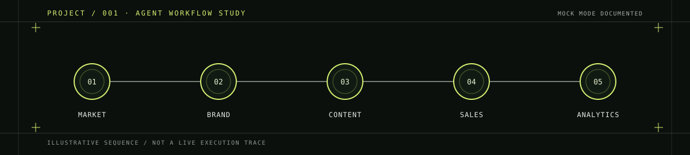](https://github.com/0xyz-exe/Autonomous-Business-Builder)

A Next.js/FastAPI prototype sequencing five business-planning agents: market research, branding, content generation, sales automation, and analytics. The repository documents a local mock mode for testing the orchestration layer without external API dependencies. No automated test suite or hosted demo currently listed.

**Stack:** `NEXT.JS` `TYPESCRIPT` `FASTAPI` `SQLALCHEMY`

---

<code>PROJECT / 002</code> &nbsp; <code>PAYMENTS · REFERENCE IMPLEMENTATION</code>

### [CryptoMerchant ↗](https://github.com/0xyz-exe/CryptoMerchant)

[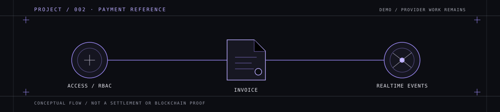](https://github.com/0xyz-exe/CryptoMerchant)

A Next.js/NestJS reference implementation exploring merchant authentication, invoice generation, and realtime event delivery for payment workflows. The repository includes test files for auth and invoice modules. README lists blockchain-provider integration as planned future work—this is not production payment infrastructure.

**Stack:** `NESTJS` `NEXT.JS` `PRISMA` `POSTGRESQL` `SOCKET.IO`

---

<code>PROJECT / 003</code> &nbsp; <code>AI INFRASTRUCTURE · STARTER</code>

### [AI-Workforce-Platform ↗](https://github.com/0xyz-exe/AI-Workforce-Platform)

[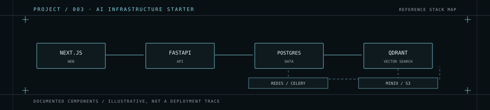](https://github.com/0xyz-exe/AI-Workforce-Platform)

A multi-tenant AI/RAG platform starter built around Next.js, FastAPI, PostgreSQL, Qdrant vector search, Redis/Celery for async jobs, and MinIO for object storage. README reports passing local build and Docker Compose validation. No automated test suite or license file present in the current repository state.

**Stack:** `NEXT.JS` `FASTAPI` `QDRANT` `REDIS/CELERY` `MINIO`

---

## Featured Engineering Projects — 2026

### [MigrationPilot ↗](https://github.com/0xyz-exe/migrationpilot)

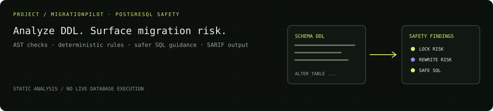

PostgreSQL migration safety analyzer with AST-based DDL analysis, deterministic rules, risk explanations, zero-downtime SQL guidance, CLI checks, and SARIF output. **Stack:** `TYPESCRIPT` `POSTGRESQL` `NODE.JS`.

### [AI Privacy Gateway ↗](https://github.com/0xyz-exe/ai-privacy-gateway)

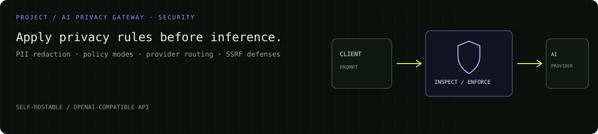

Self-hostable, OpenAI-compatible AI proxy with PII redaction, privacy policy modes, request-scoped restoration, provider routing, and SSRF defenses. **Stack:** `PYTHON` `FASTAPI` `REACT` `DOCKER`.

### [OSS Dependency Intelligence ↗](https://github.com/0xyz-exe/oss-dependency-intelligence)

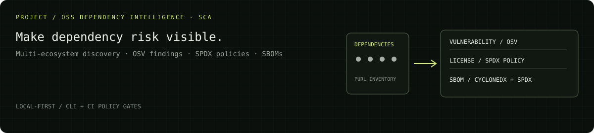

Local-first software composition analysis for multi-ecosystem dependency discovery, OSV vulnerability checks, SPDX license policies, and CycloneDX/SPDX SBOM exports. **Stack:** `PYTHON` `FASTAPI` `REACT` `SQLITE`.

### [DataSphere ↗](https://github.com/0xyz-exe/datasphere)

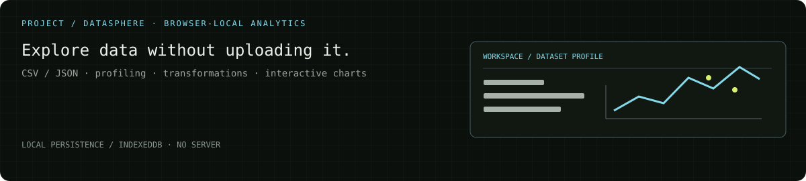

Browser-local CSV/JSON analytics workspace with profiling, transformations, interactive 2D/3D visualizations, and IndexedDB persistence. **Stack:** `REACT` `TYPESCRIPT` `ECHARTS` `THREE.JS`.

---

## 03 / GitHub Activity

  

  

  

**Data sources:**
- [Profile overview / contribution activity ↗](https://github.com/0xyz-exe?tab=overview)
- [Public repositories / source of language data ↗](https://github.com/0xyz-exe?tab=repositories)

Stats, streaks, and language proportions reflect live public GitHub data and may be delayed or rate-limited. Top languages describe code volume across public repositories—not proficiency.

Widgets provided by [github-readme-stats](https://github.com/anuraghazra/github-readme-stats) and [GitHub Streak Stats](https://github.com/DenverCoder1/github-readme-streak-stats).

---

## 04 / Outbound

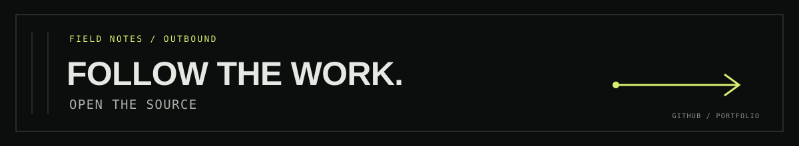

[GitHub Profile ↗](https://github.com/0xyz-exe) &nbsp; / &nbsp; [Portfolio ↗](https://0xyz-exe.github.io/)

PUBLIC CHANNELS ONLY · SURABAYA, INDONESIA
