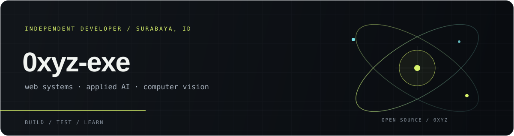
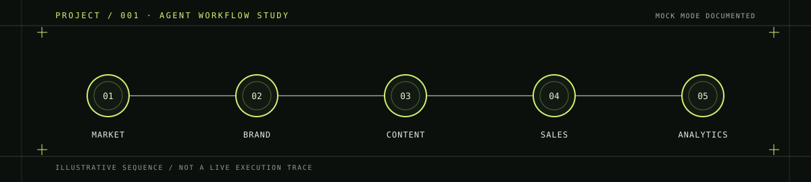
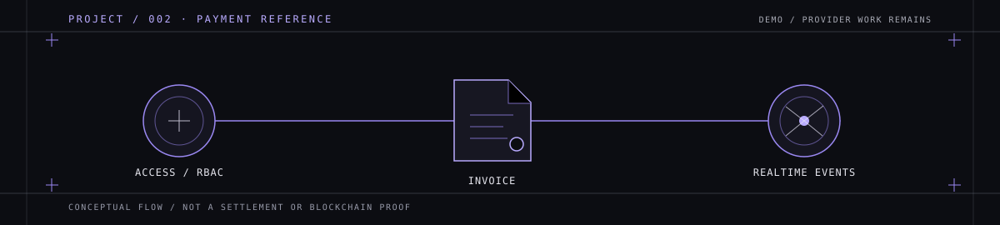
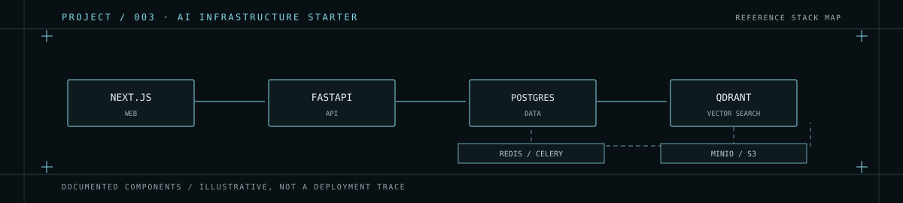

# SYSTEM IDENTITY / 001

**Building systems at the edge of software and intelligence.**

I build and explore web software, AI-oriented tools, multi-agent workflows, and computer-vision projects. Developer based in Surabaya, Indonesia.

[OPEN PORTFOLIO ↗](https://0xyz-exe.github.io/)

FIELD NOTE / Interface systems · orchestration experiments · applied vision

## 01 / Project index

Each panel is an original illustration of a documented project concept, not a screenshot or a claim that an integration is production-ready.

<code>PROJECT / 001</code> &nbsp; <code>AGENT WORKFLOW · PROTOTYPE</code>

### [Autonomous-Business-Builder ↗](https://github.com/0xyz-exe/Autonomous-Business-Builder)

A Next.js/FastAPI prototype that sequences five business-planning agents: market research, branding, content, sales, and analytics. The README documents a local mock mode; no automated tests or hosted demo are listed.

`NEXT.JS` &nbsp; `TYPESCRIPT` &nbsp; `FASTAPI` &nbsp; `SQLALCHEMY`

<code>PROJECT / 002</code> &nbsp; <code>PAYMENTS · REFERENCE IMPLEMENTATION</code>

### [CryptoMerchant ↗](https://github.com/0xyz-exe/CryptoMerchant)

A Next.js/NestJS reference implementation for merchant auth, invoices, and realtime events. Auth/invoice test files are present; its README lists blockchain-provider integrations as future work—not production payment infrastructure.

`NESTJS` &nbsp; `NEXT.JS` &nbsp; `PRISMA` &nbsp; `POSTGRESQL` &nbsp; `SOCKET.IO`

<code>PROJECT / 003</code> &nbsp; <code>AI INFRASTRUCTURE · STARTER</code>

### [AI-Workforce-Platform ↗](https://github.com/0xyz-exe/AI-Workforce-Platform)

A multi-tenant AI/RAG starter built around Next.js, FastAPI, PostgreSQL, Qdrant, Redis/Celery, and MinIO. Its README reports local build/Compose checks (not rerun here); I found no automated tests or `LICENSE` file.

`NEXT.JS` &nbsp; `FASTAPI` &nbsp; `QDRANT` &nbsp; `REDIS / CELERY` &nbsp; `MINIO`

## 🛠 My Tech Stack

  

Also in the featured projects: FastAPI · NestJS · SQLAlchemy · Prisma · Socket.IO · Qdrant · Celery · MinIO · OpenCV · YOLO.

## 📊 GitHub Stats

  
  

  

- [PROFILE OVERVIEW / contribution activity ↗](https://github.com/0xyz-exe?tab=overview)
- [PUBLIC REPOSITORIES / current source of project data ↗](https://github.com/0xyz-exe?tab=repositories)

Stats, streaks, and language proportions come from live public GitHub data and may be delayed or rate-limited. Top languages describe code volume across public repositories—not proficiency.

Cards use the public [github-readme-stats](https://github.com/anuraghazra/github-readme-stats) and [GitHub Streak Stats](https://github.com/DenverCoder1/github-readme-streak-stats) services.

## 04 / Outbound

[GitHub profile ↗](https://github.com/0xyz-exe) &nbsp; / &nbsp; [Portfolio ↗](https://0xyz-exe.github.io/)

PUBLIC CHANNELS ONLY · SURABAYA, INDONESIA
