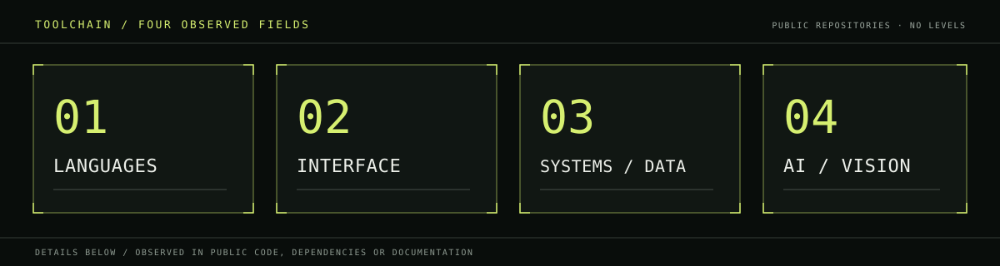
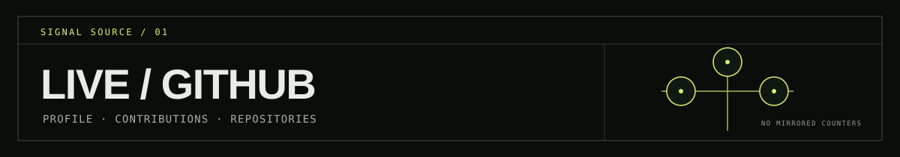

# SYSTEM IDENTITY / 001

**Building systems at the edge of software and intelligence.**

I build and explore web software, AI-oriented tools, multi-agent workflows, and computer-vision projects. Developer based in Surabaya, Indonesia.

[OPEN PORTFOLIO ↗](https://0xyz-exe.github.io/)

FIELD NOTE / Interface systems · orchestration experiments · applied vision

## 01 / Project index

Each panel is an original illustration of a documented project concept, not a screenshot or a claim that an integration is production-ready.

<code>PROJECT / 001</code> &nbsp; <code>AGENT WORKFLOW · PROTOTYPE</code>

### [Autonomous-Business-Builder ↗](https://github.com/0xyz-exe/Autonomous-Business-Builder)

A Next.js/FastAPI prototype that sequences five business-planning agents: market research, branding, content, sales, and analytics. The README documents a local mock mode; no automated tests or hosted demo are listed.

`NEXT.JS` &nbsp; `TYPESCRIPT` &nbsp; `FASTAPI` &nbsp; `SQLALCHEMY`

<code>PROJECT / 002</code> &nbsp; <code>PAYMENTS · REFERENCE IMPLEMENTATION</code>

### [CryptoMerchant ↗](https://github.com/0xyz-exe/CryptoMerchant)

A Next.js/NestJS reference implementation for merchant auth, invoices, and realtime events. Auth/invoice test files are present; its README lists blockchain-provider integrations as future work—not production payment infrastructure.

`NESTJS` &nbsp; `NEXT.JS` &nbsp; `PRISMA` &nbsp; `POSTGRESQL` &nbsp; `SOCKET.IO`

<code>PROJECT / 003</code> &nbsp; <code>AI INFRASTRUCTURE · STARTER</code>

### [AI-Workforce-Platform ↗](https://github.com/0xyz-exe/AI-Workforce-Platform)

A multi-tenant AI/RAG starter built around Next.js, FastAPI, PostgreSQL, Qdrant, Redis/Celery, and MinIO. Its README reports local build/Compose checks (not rerun here); I found no automated tests or `LICENSE` file.

`NEXT.JS` &nbsp; `FASTAPI` &nbsp; `QDRANT` &nbsp; `REDIS / CELERY` &nbsp; `MINIO`

## 02 / Technology constellation

- **LANGUAGES** &nbsp; TypeScript · JavaScript · Python · PHP
- **FRONTEND** &nbsp; React · Next.js · Vite · Tailwind CSS
- **BACKEND / DATA** &nbsp; FastAPI · NestJS · PostgreSQL · Qdrant · Redis · MinIO
- **AI / VISION** &nbsp; OpenAI APIs · retrieval-augmented workflows · YOLO · OpenCV · CLAHE

These are technologies visible in public repository metadata, code, or documentation; no skill levels are implied.

## 03 / Live signal

- [PROFILE OVERVIEW / contribution activity ↗](https://github.com/0xyz-exe?tab=overview)
- [PUBLIC REPOSITORIES / current source of project data ↗](https://github.com/0xyz-exe?tab=repositories)

GitHub is the live source for repository and contribution information. No mirrored counts or third-party statistics widgets are used here.

## 04 / Outbound

[GitHub profile ↗](https://github.com/0xyz-exe) &nbsp; / &nbsp; [Portfolio ↗](https://0xyz-exe.github.io/)

PUBLIC CHANNELS ONLY · SURABAYA, INDONESIA
